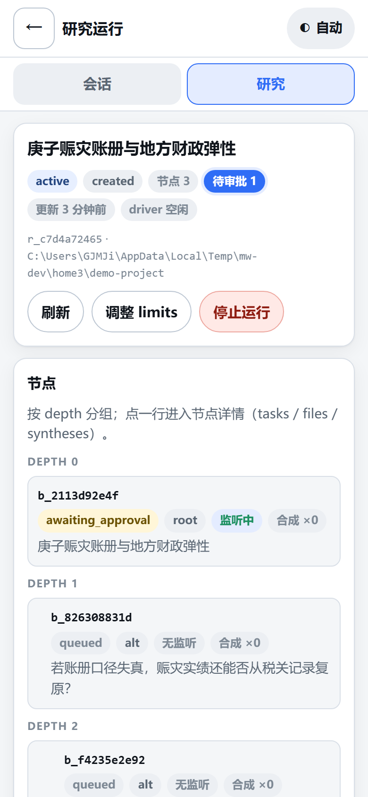
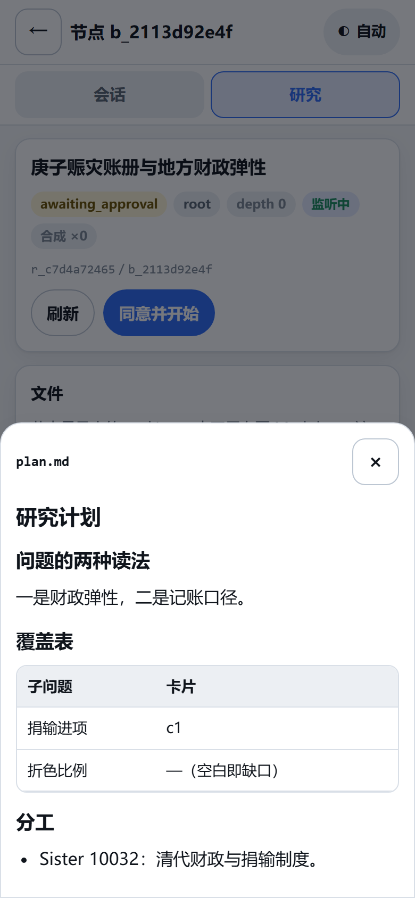
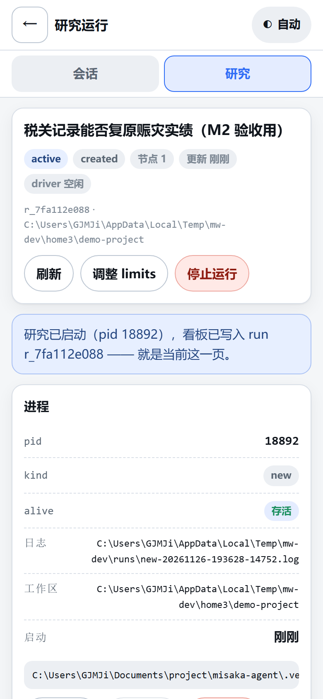
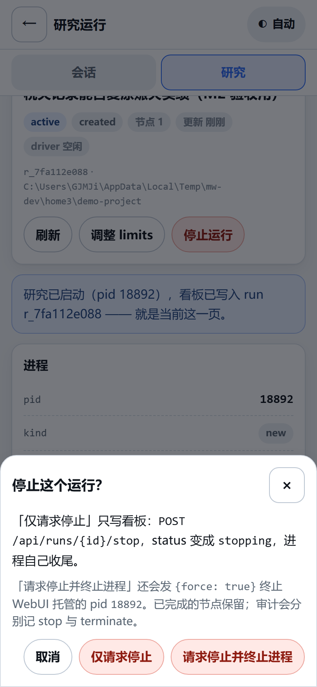

# misaka-web

MISAKA 的移动优先 WebUI：把服务器上的研究会话与研究运行搬到手机/平板的浏览器里。

**M0（已交付）**：token 登录 → 会话列表 → 单会话实时流（SSE 增量）→ 发消息 / 暂停 / 恢复。
**M1（已交付）**：研究列表 → 运行详情（节点按 depth 分组、limits、停止）→ 节点页（tasks / files / syntheses）→ 手写 Markdown 渲染 → **审批即对话**（把「同意」发给该节点的 Last Order）。
**M2（已交付）**：在手机上**新建研究**（九参数中的六个 + 诊断）→ 托管 `misaka research` 子进程 → 进程区块（pid / kind / alive / 日志）→ 查看日志 → 恢复运行 → 双档停止（仅请求停止 / 请求停止并终止进程）。

| 会话流式 | 研究列表 | 运行详情 | 节点 Markdown | 审批二次确认 |
|---|---|---|---|---|
|  |  |  |  |  |

| 新建研究 | 进程区块 | 双档停止 |
|---|---|---|
|  |  |  |

（截图全部来自 `scripts/dev-demo.py` 的真实链路：React ⇄ SSE / REST ⇄ 控制 socket + 真看板 ⇄ 会话属主进程，390×844，DSF 2；横向溢出实测为 0。）

## 它怎么工作

```
手机/平板 PWA --HTTPS--> Caddy --127.0.0.1:8787--> misaka-web
  |-- 控制 socket（snapshot / input / pause / resume）--> 会话属主进程
  |-- 只读 ~/.misaka（catalog / board.db）
  |-- 写：仅 stop / limits（上游动词）+ 审计 audit.jsonl
  +-- 包内 static/（构建好的前端，服务器不装 node）
```

三条不可违背的约束：不读写 session 文件；审批不是写看板而是给节点的 Last Order 发一条消息；服务器不装 node。契约见 `CONTRACT.md`。

## 开发

```sh
python -m venv .venv && . .venv/bin/activate
pip install -e '.[dev]'          # 研究面需要 misaka 在同一环境里
python -m misaka_web token       # 生成 token（0600）
python -m misaka_web serve       # 127.0.0.1:8787
pytest -q                        # 53 项：认证/协议/看板/审批/审计/进程托管
```

没有真实 MISAKA 运行也能看完整界面：

```sh
python scripts/dev-demo.py       # 假会话属主 + 种一份 demo 看板（2 run / 3 层节点 / plan·cards·synthesis·SOURCES）
```

前端：

```sh
cd web && pnpm install
pnpm dev                         # VITE_MOCK=1 时纯前端 mock，无需后端
pnpm exec vite build && ../scripts/sync-web.sh   # 产物进包内 static/
```

## 部署

`docs/ops.md` 是完整运维文档（安装、token 轮换、升级、备份、加固、排障）。最短路径：

```sh
./deploy/install.sh --with-misaka     # 研究面需要 misaka 在同一个 venv 里
sudo cp deploy/systemd/misaka-web.service /etc/systemd/system/   # 改 User/Group/HOME/ExecStart
sudo systemctl enable --now misaka-web
```

**不要给这个服务开 `PrivateTmp=yes`**：MISAKA 的控制 socket 在 `/tmp/misaka-session-*/`，私有 /tmp 会让所有会话不可达（`/api/health` 的 `control_parent` 会暴露这件事）。