# misaka-web

MISAKA 的移动优先 WebUI：把服务器上的研究会话与研究运行搬到手机/平板的浏览器里。

**M0（已交付）**：token 登录 → 会话列表 → 单会话实时流（SSE 增量）→ 发消息 / 暂停 / 恢复。
**M1（已交付）**：研究列表 → 运行详情（节点按 depth 分组、limits、停止）→ 节点页（tasks / files / syntheses）→ 手写 Markdown 渲染 → **审批即对话**（把「同意」发给该节点的 Last Order）。
**M2（已交付）**：在手机上**新建研究**（九参数中的六个 + 诊断）→ 托管 `misaka research` 子进程 → 进程区块（pid / kind / alive / 日志）→ 查看日志 → 恢复运行 → 双档停止（仅请求停止 / 请求停止并终止进程）。
**M3（已交付）**：来源面板（`SOURCES.md` 解析出的 placed / original / sha256 / 定位符 / 页码）→ 正文引用可点（`doc:<id>#p<n>` 精确命中才跳，否则只高亮不猜）→ 文件 sheet 用浏览器内建 PDF 查看器 + `#page=` + 新标签兜底（iOS 走专门的分支）→ `/file` 支持 Range（206）。
**M4（已交付）**：手写 Service Worker 离线壳（`/api/` 与文件流一律不缓存；构建时把 hash 资源清单盖进 `sw.js`）+ 更新/离线 banner → 打印/导出样式（只打印内容，不打印界面）→ 审计日志页（`#/audit`）→ 可见性轮询的待办计数（标签标题 + tab 圆点）→ `misaka-web doctor` 与升级 runbook。
**M7（已交付）**：失效条目的清理——项目文件夹没了时，研究/会话卡片上会出现「项目文件已删除」徽标；可以单条「从列表隐藏」或一键「隐藏所有失效项」，并有「显示已隐藏」开关可恢复。上游没有删除 API，所以这是**可逆的隐藏**（记在 `<token 目录>/hidden.json`，全程审计），不动 MISAKA 的看板与会话文件。
**M6（已交付）**：聊天框里可以用斜杠命令——`/help`、`/research status|stop|resume|limits|tell`、`/sister ID`、`/model`、`/board`。这些由**桥接层解析**（结构化气泡、不进模型上下文），其它命令会给出等价路径；`//` 开头仍按上游约定原样发给模型。
**M5（已交付）**：手机上的**配置台** `#/settings`——切 provider/模型（全局 + 每个角色）、设置或更换 API key（白名单写 `~/.misaka/.env`，只回显前 4 位）、增删改 Sisters、新建项目目录（自动 git init + PROJECT.md）；全部二次确认 + 审计。

| 会话流式 | 研究列表 | 运行详情 | 节点 Markdown | 审批二次确认 |
|---|---|---|---|---|
| 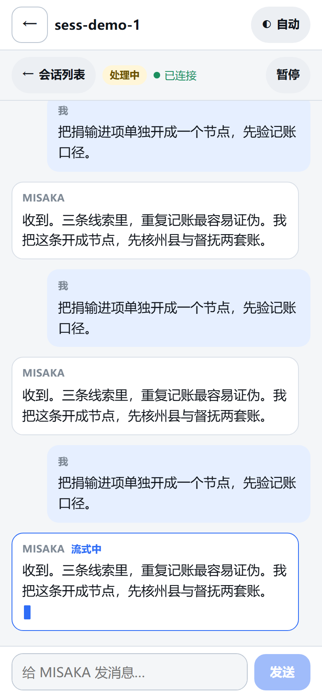 | 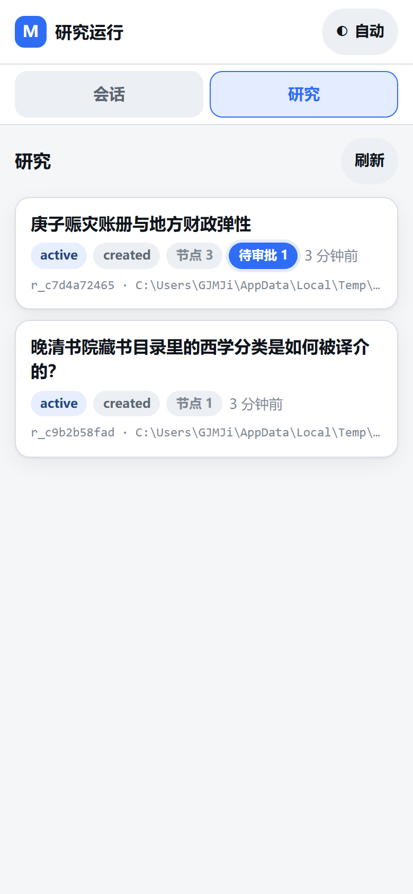 |  |  | 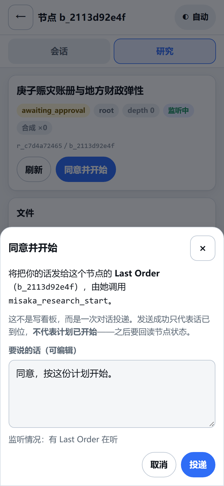 |

| 新建研究 | 进程区块 | 双档停止 |
|---|---|---|
| 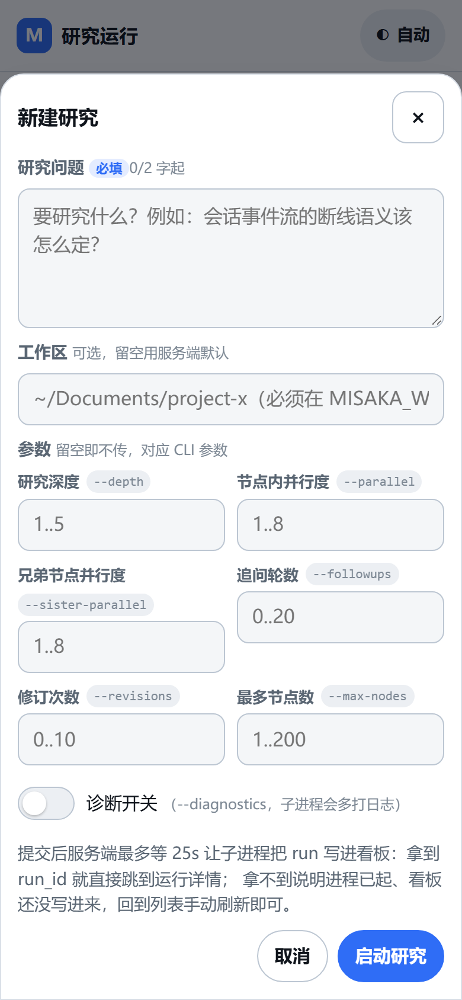 |  |  |

| 来源面板 | 引用跳转（PDF 第 3 页） | 审计日志 | 打印/导出 | 离线壳 |
|---|---|---|---|---|
| 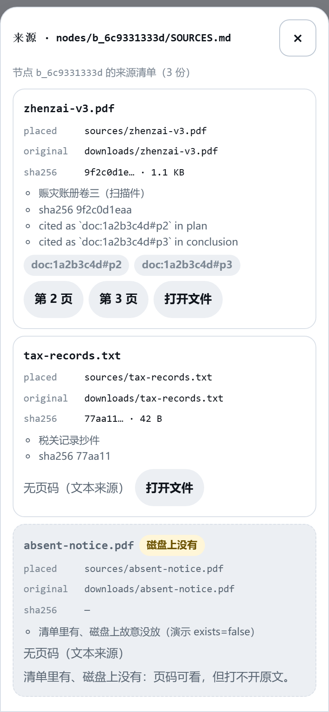 | 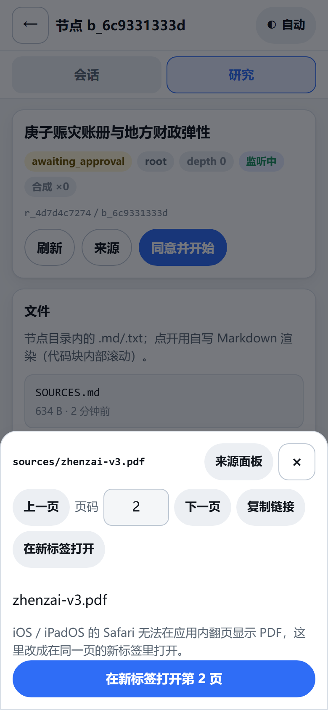 | 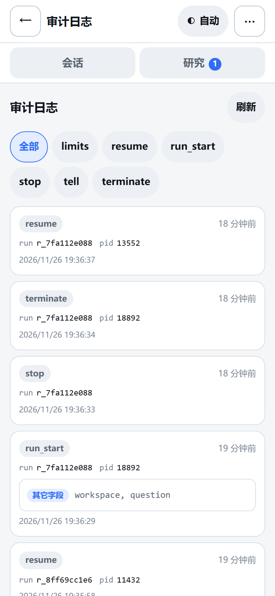 | 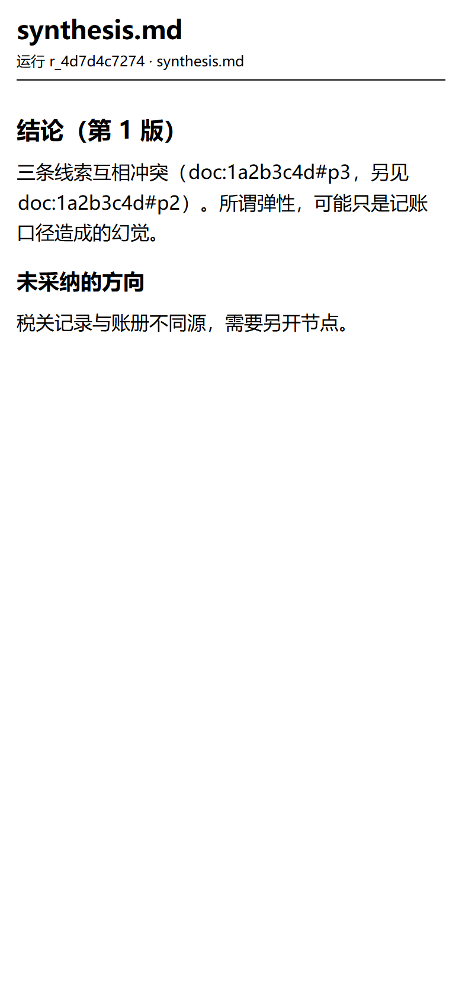 | 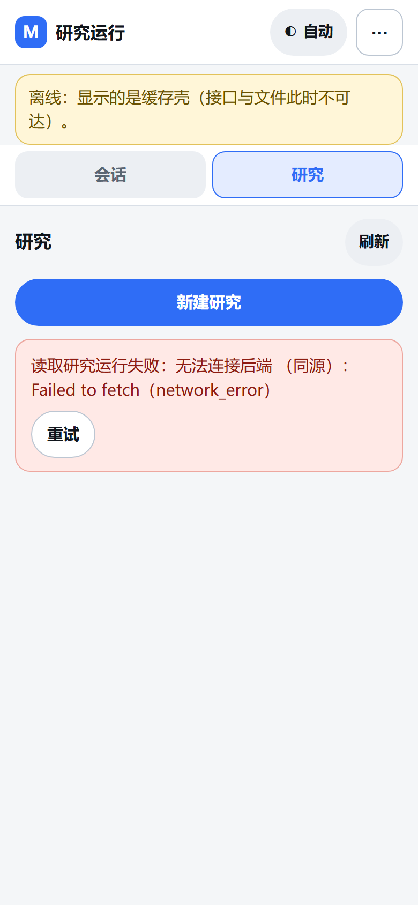 |

| 失效条目（可一键隐藏） | 显示已隐藏 |
|---|---|
| 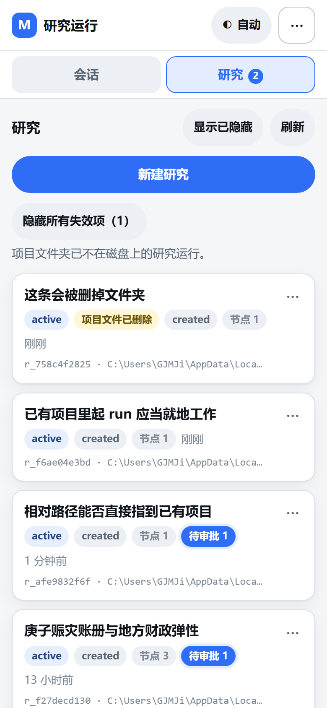 | 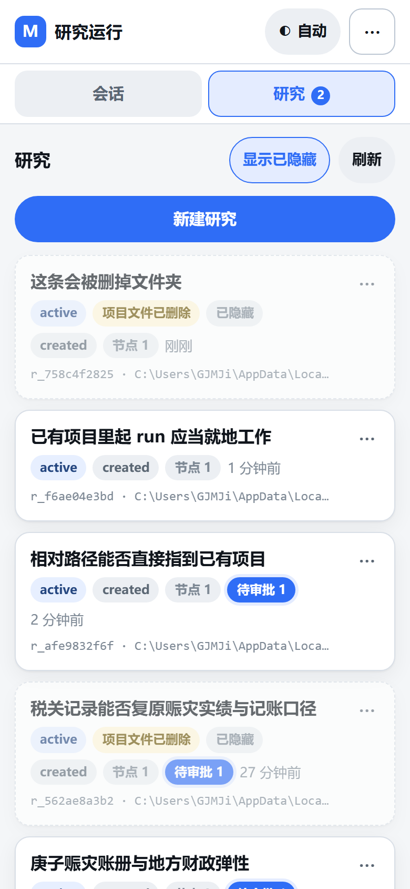 |

| 命令气泡（`/research status`） | 命令补全 |
|---|---|
| 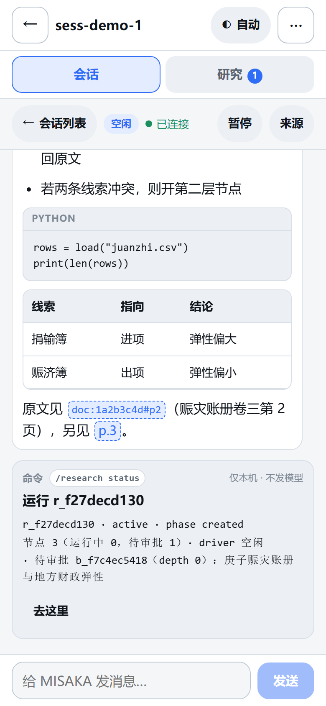 | 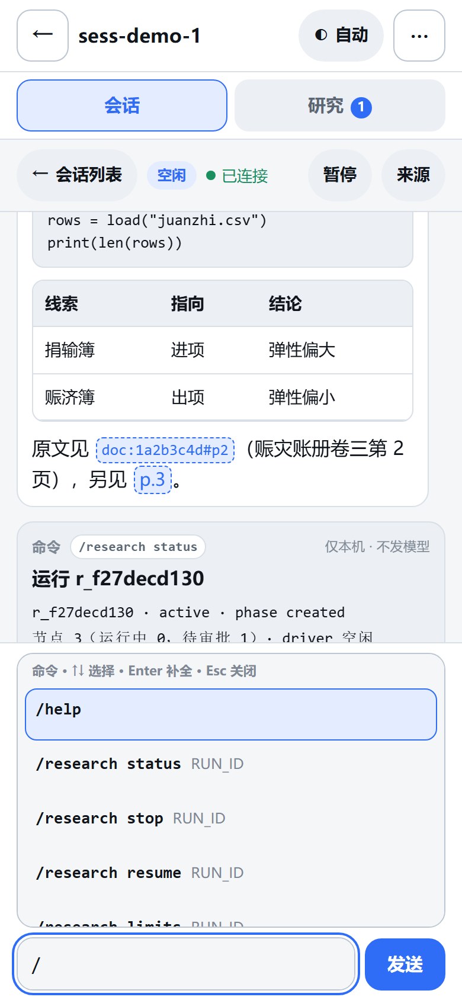 |

| 设置 · 模型与密钥 | 设置 · Sisters | 设置 · 项目 |
|---|---|---|
| 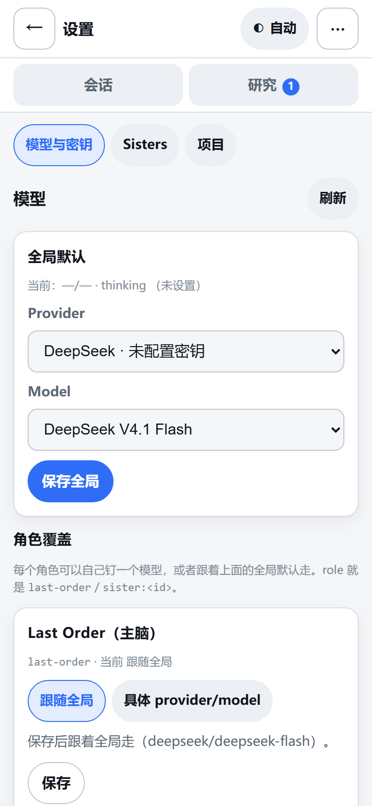 | 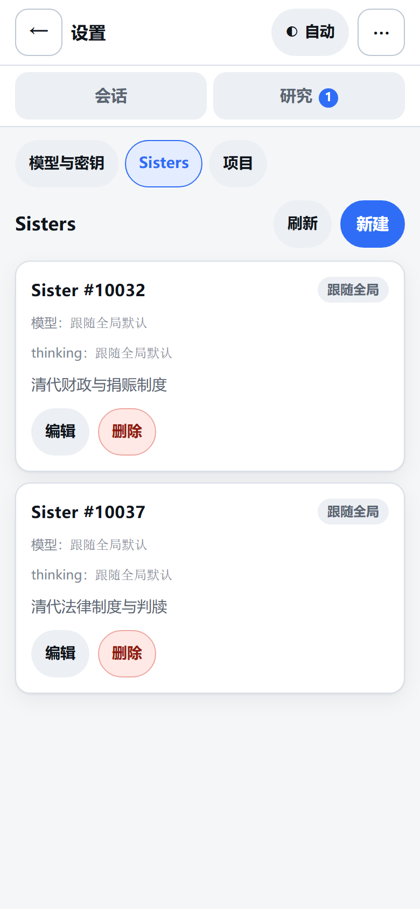 | 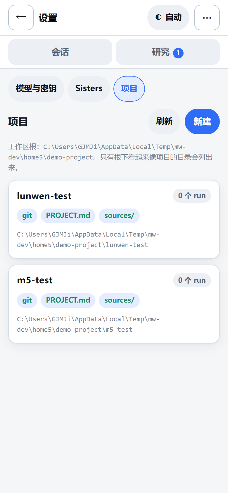 |

_（上一行的表头与分隔线属于上面那张表；这一行起是 M5 的三张截图。）_
|---|---|---|---|---|
|  |  |  |  |  |
|---|---|---|
|  |  |  |

（截图全部来自 `scripts/dev-demo.py` 的真实链路：React ⇄ SSE / REST ⇄ 控制 socket + 真看板 ⇄ 会话属主进程，390×844，DSF 2；横向溢出实测为 0。）

## 它怎么工作

```
手机/平板 PWA --HTTPS--> Caddy --127.0.0.1:8787--> misaka-web
  |-- 控制 socket（snapshot / input / pause / resume）--> 会话属主进程
  |-- 只读 ~/.misaka（catalog / board.db）
  |-- 产物文件（只读，realpath 白名单，支持 Range）
  +-- 包内 static/（构建好的前端，服务器不装 node）
```

三条不可违背的约束：不读写 session 文件；审批不是写看板而是给节点的 Last Order 发一条消息；服务器不装 node。契约见 `CONTRACT.md`。

## 开发

```sh
python -m venv .venv && . .venv/bin/activate
pip install -e '.[research]'     # 研究与来源面需要 misaka 在同一环境；只测会话可用 .（不加 extra）
# 注意：misaka 不在 PyPI —— PyPI 上那个 misaka 是另一个项目（markdown 绑定）。
#      [research] 用的是 git 直链（tag v0.19.30）；github 不可达时请用本地 checkout：
#      pip install -e /path/to/Misaka-Agent && pip install -e .
python -m misaka_web token       # 生成 token（0600）
python -m misaka_web serve       # 127.0.0.1:8787
python -m misaka_web doctor      # 部署自检：token/产物/看板/控制 socket/工作区
pytest -q                        # 111 项：认证/协议/看板/审批/审计/进程托管/来源与 Range/配置台/命令/隐藏
```

没有真实 MISAKA 运行也能看完整界面：

```sh
python scripts/dev-demo.py       # 假会话属主 + 种一份 demo 看板（2 run / 3 层节点 / plan·cards·synthesis·SOURCES）
```

前端：

```sh
cd web && pnpm install
pnpm dev                         # VITE_MOCK=1 时纯前端 mock，无需后端
pnpm exec vite build && ../scripts/sync-web.sh   # 产物进包内 static/，并给 sw.js 盖上资源清单
```

## 部署

`docs/ops.md` 是完整运维文档（安装、token 轮换、升级、备份、加固、排障）。最短路径：

```sh
./deploy/install.sh --with-misaka            # venv + 依赖 + token + 自检
# 它会在终端里问你要 token（直接回车＝自动生成一个并只打印这一次）；也可以：
#   ./deploy/install.sh --token 'xxx' / --token-stdin / --generate --yes
#   ./deploy/install.sh --lan                  # 绑 0.0.0.0 供内网手机访问（会说明代价）
#   ./deploy/install.sh --systemd              # 生成并启用 systemd 单元（需要 root）
#   ./deploy/install.sh --print-caddy --lan    # 打印内网 Caddy 片段（tls internal）
```

**不要给这个服务开 `PrivateTmp=yes`**：MISAKA 的控制 socket 在 `/tmp/misaka-session-*/`，私有 /tmp 会让所有会话不可达（`/api/health` 的 `control_parent` 会暴露这件事）。