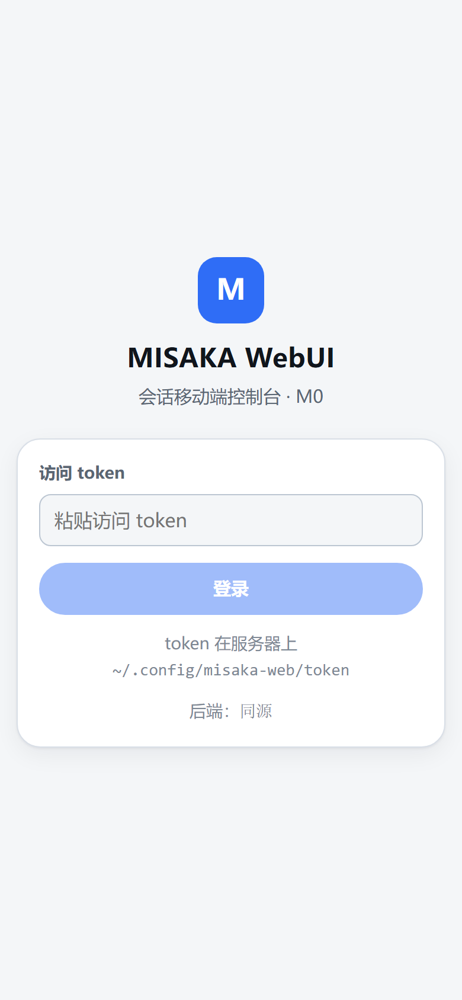
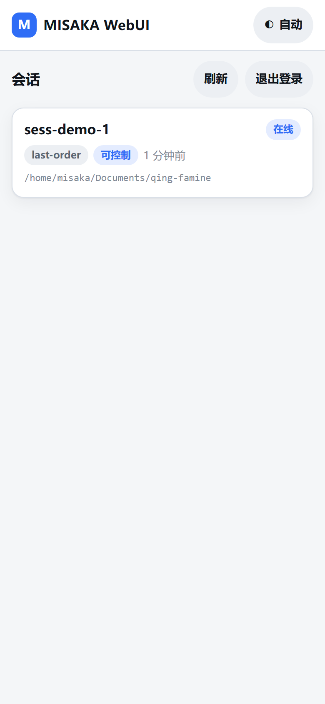
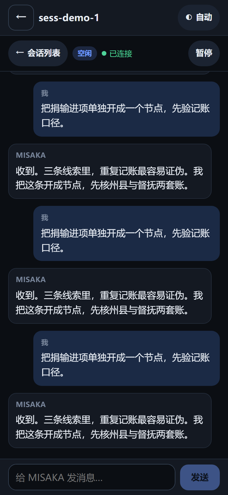

# misaka-web

MISAKA 的移动优先 WebUI：把服务器上的研究会话搬到手机/平板的浏览器里。

**M0 已交付**：token 登录 → 会话列表 → 单会话实时流（SSE 增量）→ 发消息 / 暂停 / 恢复；部署侧有 systemd 单元、Caddy 反代与幂等安装脚本。研究运行面（run/节点/计划/产物）留给 M1。

| 手机登录 | 会话列表 | 流式对话 | 深色 |
|---|---|---|---|
|  |  |  |  |

（截图来自 `scripts/dev-demo.py` 的真实链路：React ⇄ SSE ⇄ 控制 socket ⇄ 会话属主进程，390×844，DSF 2。）

## 它怎么工作

```
手机/平板 PWA --HTTPS--> Caddy --127.0.0.1:8787--> misaka-web
  |-- 控制 socket（snapshot / input / pause / resume）--> 会话属主进程
  |-- 只读 ~/.misaka（catalog / board.db）
  +-- 包内 static/（构建好的前端，服务器不装 node）
```

不做的事：不读写 session 文件、不扮演第二个写者、不在服务器上跑 node。契约见 `CONTRACT.md`。

## 开发

```sh
python -m venv .venv && . .venv/bin/activate
pip install -e '.[dev]'
python -m misaka_web token            # 生成 token（0600）
python -m misaka_web serve            # 127.0.0.1:8787
pytest -q                             # 服务器与协议测试
```

没有真实 MISAKA 会话也能看界面：

```sh
python scripts/dev-demo.py            # 假会话属主 + 真服务，可对话、可流式
```

前端：

```sh
cd web && pnpm install
pnpm dev                              # VITE_MOCK=1 时纯前端 mock，无需后端
pnpm exec vite build && ../scripts/sync-web.sh   # 产物进包内 static/
```

## 部署

`docs/ops.md` 是完整运维文档（安装、token 轮换、升级、备份、加固、排障）。最短路径：

```sh
./deploy/install.sh
sudo cp deploy/systemd/misaka-web.service /etc/systemd/system/   # 改 User/Group/HOME/ExecStart
sudo systemctl enable --now misaka-web
```

**不要给这个服务开 `PrivateTmp=yes`**：MISAKA 的控制 socket 在 `/tmp/misaka-session-*/`，私有 /tmp 会让所有会话不可达（`/api/health` 的 `control_parent` 会暴露这件事）。
