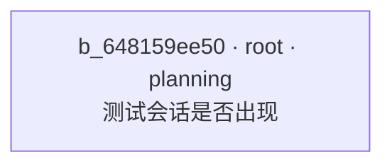

# Research graph — run r_dd9fe64caa

Written by misaka from the run's records after every change; edit nothing here, it is rewritten.

Question: 测试会话是否出现

Every possibility raised so far, and where it went: `final\r_dd9fe64caa-paths.md`.

Status: active/active · limits: depth 1, nodes 1/2, revisions 2, follow-ups 2

## Nodes

| Node | Kind | Depth | Status | Question | Parents | Reached by | Conclusion (latest) | Issues |
| --- | --- | --- | --- | --- | --- | --- | --- | --- |
| `b_648159ee50` | root | 0 | planning | 测试会话是否出现 | - | - | `-` | - |

## Decisions and options

No decision recorded yet.
## Relations

No relation recorded.

## Reconciliations

None yet.

## Corrections (errata)

None recorded.
